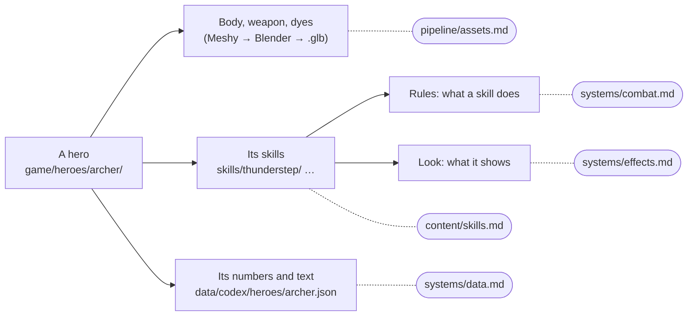

# Heroes

What a hero is made of, how to make a new one, and how to improve one. The Archer (`game/heroes/archer/`) is the
example. It is being rebuilt as the template ([the plan](../architecture_cleanup.md)), so check it before copying.

## A hero, and which doc covers each piece



Changing a hero touches two to four of these docs, never all of them: a new look for a skill is
[skills](skills.md) and [effects](../systems/effects.md); a damage change is [skills](skills.md),
[data](../systems/data.md) and [combat](../systems/combat.md).

## A hero's folder

Everything one hero owns lives in `game/heroes/<hero>/`:

```
game/heroes/archer/
  archer.gd              the hero's skills script (ClassSkills interface) and its body (Knight.build_mocap)
  archer_fx.gd           its effects handler: draws its fx events
  body/                  the model (archer_ranger.glb) and dyes/
  weapon/                the bow and arrows/
  skills/<skill>/        one folder per skill: its rules, its look, its own models
  companion/             what it summons (spirit_beast.gd; the wolf's model is still assets/models/monsters/wolf.glb)
  shared/                what only this hero's skills share (the Plague Doctor has one)
  build/                 Blender and other build scripts (never imported: .gdignore)
  tests/                 its headless tests
  tools/                 previews, shots and clips
```

`tests/`, `tools/` and `build/` never ship ([builds](../pipeline/builds.md)). A hero's numbers and text are
not here: they are in `data/codex/heroes/<hero>.json` ([data](../systems/data.md)). Its sounds are in
`assets/audio/sfx/` and its icons in `assets/textures/skills/` and `talents/`.

Heroes not moved yet still live in `scripts/<hero>*.gd` and `assets/models/`.

**Where the game names a hero.** These are the places a new hero must be added (Doug needed all of them):
- `ClassSkills.of`, `all` and `trail_color` (`scripts/class_skills.gd`); `SkillFx._play`, `update` and `clear`
  (`scripts/skill_fx.gd`);
- `Hero.is_<id>` and `_build_rig` (`scripts/hero.gd`);
- `Net.STYLES` (append new styles at the end);
- the weapon in `Models.item_model`;
- `Data.CLASSES` and `Data.SKILLS` (`scripts/data.gd`);
- `Talents.TREES` and `AUTO` (`scripts/talents.gd`); `RunTalents`' themes and `TREE_THEME` (`scripts/run_talents.gd`);
- the class picker, `ClassStage` (`CLASSES`, `ACCENTS`, `EMBLEMS`, `SIGNATURE`, `SKILL_SHOW`, `PICK_SOUND`);
- `MpLobbyView.PLAYSTYLE`, `BgMatchup.ACCENTS`, and the Sandbox's stats (`game/maps/arena/sandbox.gd`).

The Archer's rebuild aims to shrink this list ([the plan](../architecture_cleanup.md), step 2).

## Making a hero

It was first run with Doug. Each step names its tool, what it costs, and the check that must pass before the next.

0. **Brief → codex (no credits).**
   - Write `data/codex/heroes/<id>.json` from the admin's description and references. It holds the fantasy, three
     directions, the skills and the rites.
   - The kit: LMB attack, RMB and Q E R (the base kit), F G V (stronger skills, V the ultimate).
   - Post a kit summary to Discord. For every skill it says what it does, why it's fun in PvP, **the answer to it**
     (counterplay), and whether it's a damage skill (no cooldown) or a utility one (cooldown and a tag). The codex
     has no counterplay field, so the summary is where it's kept.
   - Gate: every skill has a counterplay line, and no button carries more than one hard crowd control.
1. **Concept art (Meshy 2D, ~6 credits a take).** `tools/meshy/meshy.py edit <reference.png> "<prompt>" --ref <other>
   --aspect 3:4` or `meshy.py draw "<prompt>" --aspect 3:4`, at least three takes for the admin to pick from. Full body, symmetrical A-pose, arms a
   little away from the body, front view, plain grey background, even light. Gate: the whole body is visible, and
   the hands are empty or the prop is clear of the body.
2. **Model (Meshy image-to-3D, ~30 credits).** `meshy.py image <concept.png> -o <dir> --pose a-pose --polys 60000`.
   Gate: it matches the concept, the silhouette is clean, and no limbs are fused. Held props usually drop out, so
   make them separately (step 5).
3. **Rig and clips (auto-rig 5 credits, clips ~3 each).** `meshy.py rig <image task id> --height <m>`. Pick clips
   with `meshy.py library <search>` (free): idle, walk, run, every skill's whole-body move, a three-blow combo, hit,
   death. Then `meshy.py animate <rig task id> <ids>`, 6–8 at a time.
4. **Body in Blender (local).** Copy another hero's `build/prep_*_mocap.py` into `game/heroes/<id>/build/`, and map
   the clip names it prints ("dropped clip ...") to the game's names. Export `body/<model>.glb`. Keep the `.blend`
   outside the project. Gate: every clip the hero needs is in the export. The Plague Doctor's and Doug's prep scripts
   print "MISSING" for any that isn't; the Archer's doesn't check.
5. **Props (Meshy text-to-3D, ~10 credits each).** One for each thing a skill throws, places or rides, prepared into
   the skill's own folder ([assets](../pipeline/assets.md)). Gate: the right object, the right way up, the right
   size, textured, ≤10k triangles, 1k textures.
6. **Code.** Copy the Archer's files and follow [skills](skills.md) for each skill. Add the hero to every place in
   "Where the game names a hero" above.
7. **Gates.**
   - The hero's own test in `tests/` (each skill's gameplay).
   - `tools/coop_fx_test.gd` (every skill reaches a partner, and a replay hurts nothing), `tools/skill_spec_test.gd`,
     `tools/playtest.gd`, and `tools/bg_pvp_test.gd` (PvP hits; its crowd-control check covers only Doug's Cream Pie,
     so add one for the new hero, like `game/heroes/plague/tests/plague_pvp_test.gd`).
   - Screenshots of every skill from the game camera, posted.
8. **Sound (ElevenLabs, ~10 credits a second).** Add the hero's sounds to `tools/audio/spec.py`, run `eleven.py
   <names>` and `score.py --rank`, a human picks, then `build_sfx.py picks.json`. Until then it uses the closest
   existing sounds.

Doug cost about 190 Meshy credits: concepts 24, model 30, rig 5, clips 60, props 70.

## Improving a hero

- **A skill's numbers, text or look:** [skills](skills.md), "Improving a skill".
- **Its body or animations:** re-run its `build/prep_*_mocap.py` with new clips, and check every clip is listed.
- **Its kit:** change the codex first (the skill and its rites), post the new counterplay, then change the code and
  the test.
- Run its tests, `tools/coop_fx_test.gd`, and look at it from the game camera before you call it done.
