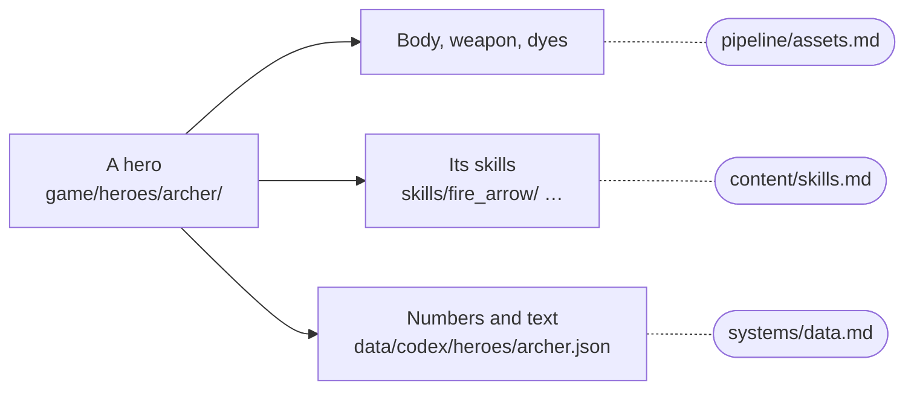

# Heroes

What a hero is made of, how to make one, and how to change one. Every hero lives in `game/heroes/<hero>/`; the
Archer (`game/heroes/archer/`) is the example.

## A hero's pieces



```
game/heroes/archer/
  archer.gd        its skills script (which skill object handles which id) and its body
  archer_fx.gd     its effects: draws its fx events
  body/ weapon/    models and dyes
  skills/<skill>/  one folder per skill: rules, look, its own models and sounds/
  shared/          what only this hero's skills share
  companion/       what it summons
  build/ tests/ tools/   Blender scripts, tests, previews (never shipped)
```

A family of heroes keeps what they all share in `game/systems/` (the three dragons: `game/systems/dragons/`), never
in one member's folder.

**Where the game names a hero.** A new hero is added to: `ClassSkills` (`of`, `all`, `trail_color`),
`ServerRules.CLASSES` (its skills run on the match server), `SkillFx` (`_play`, `update`, `clear`), `Hero`
(`is_<id>`, `_build_rig`), `Net.STYLES`, `Models.item_model`, `Data.CLASSES` and `Data.SKILLS`, `Talents.TREES`,
`RunTalents`' themes, the class picker (`ClassStage`), `MpLobbyView.PLAYSTYLE`, `BgMatchup.ACCENTS` and the
Sandbox's stats.

**A hero's own ways go in its script, never in `hero.gd`.** `ClassSkills` asks the hero's script for optional
hooks, each named for what it answers:
- attacking: `attack`, `swing` (its own weapon blows), `reach`, `free_cast`, `recast`, `stage_done` (a skill of
  several clips), `dash`, `channel` / `end_channel`, `struck` (its mark on what it hits);
- moving and the body: `pace`, `attack_pace`, `unstoppable`, `posed`, `pose`, `weapon_hand`, `hands_busy`;
- being hit: `taken`, `absorb`, `hidden_from_monster`;
- other copies of it: `puppet_update` (a partner's game), `server_update` (the match server's copy: its summons);
- PvP things of its own: `obj_pos`, `obj_hit`;
- its skill objects: `skill` (rites use it for a free cast).

## Making a hero

1. **Kit (no credits).** Write `data/codex/heroes/<id>.json`: the fantasy, three directions, the skills (LMB, RMB,
   Q E R, then F G V with V the ultimate) and the rites. Post a kit summary to Discord with each skill's counterplay.
2. **Concept art** (Meshy 2D, ~6 credits a take): at least three takes for an admin to pick from.
3. **Model** (Meshy image-to-3D, ~30 credits), **rig and clips** (~5 + ~3 each), **body in Blender** (copy another
   hero's `build/prep_*_mocap.py`). See [assets](../pipeline/assets.md).
4. **Props** for what its skills throw or place (Meshy text-to-3D, ~10 credits each), in the skill's folder.
5. **Code:** copy the Archer's files, write each skill ([skills](skills.md)), and add the hero everywhere listed above.
6. **Tests:** its own in `tests/`; its reference (`tools/hero_reference.gd <hero> record`, twice, then the compare
   on every change); a mode in `game/maps/verdant_reach/tests/bg_pvp_test.gd` proving the server made its skills;
   plus `tools/coop_fx_test.gd`, `skill_spec_test.gd` and `playtest.gd`. Post screenshots of every skill from the
   game camera.
7. **Sound** (ElevenLabs): add it to `tools/audio/spec.py`; a human picks the takes.

## Changing a hero

- Its skills: [skills](skills.md). Its numbers and text: the codex ([data](../systems/data.md)).
- Its body or animations: re-run its `build/prep_*_mocap.py` and check every clip is there.
- Run its tests and `tools/coop_fx_test.gd`, and look at it from the game camera.
