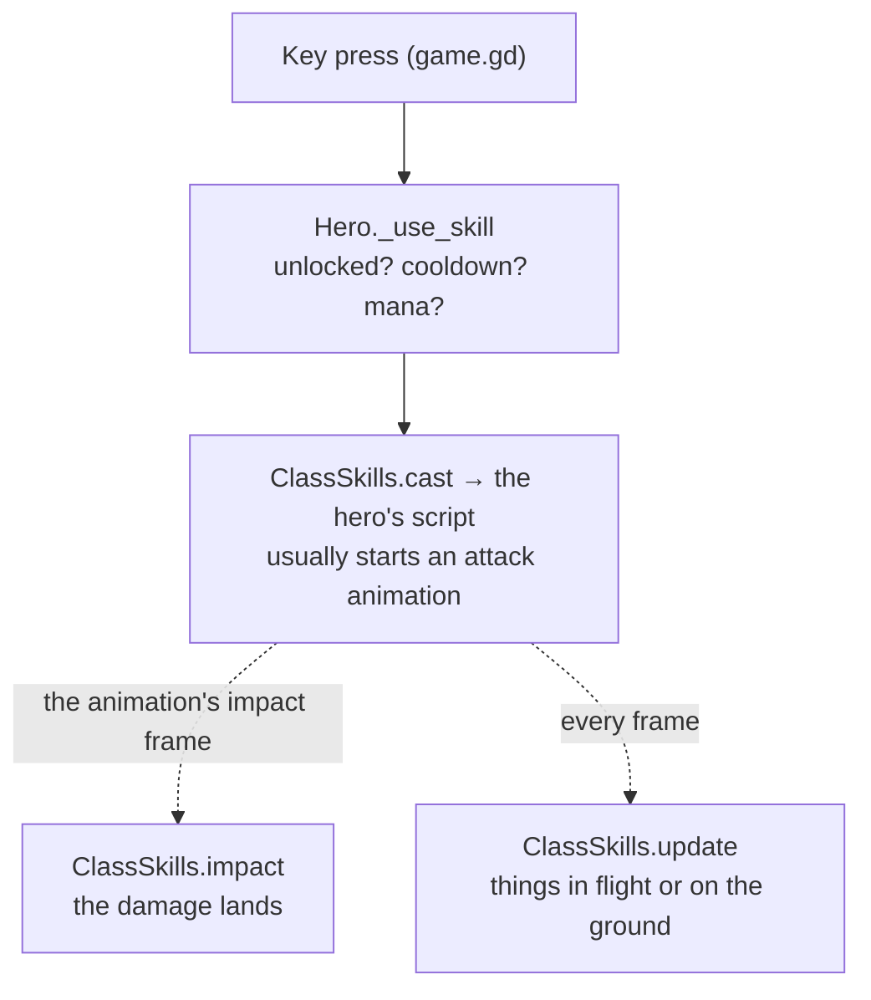

# Skills

A skill belongs to its hero (Fire Arrow is the Archer's) and runs on the skill system every skill shares.

## How a skill runs

- `scripts/class_skills.gd` routes each call to the hero's skills script, which has the same functions for every hero
  (`can_cast`, `cast`, `impact`, `update`, `rooted`, `clear`, `died`, `sound`).
- Mana, cooldown and timing come from the codex. `SkillSpec` (`scripts/skill_spec.gd`) can also take a skill's
  timing, area and damage from its data.
- Damage goes through `Hero._hit_enemy` ([combat](../systems/combat.md)). What is seen goes through
  `h.fx(skill, event, data)` ([effects](../systems/effects.md)).

## How the Archer's skills are built

The Archer is the example to copy. Most other heroes still keep every skill in one script.
- **One folder per skill:** `game/heroes/archer/skills/fire_arrow/fire_arrow.gd` is the rules, a `Skill` object
  (`game/systems/skills/skill.gd`) holding its own state and reading its numbers with `val("dmg", 130)`.
  `archer.gd` keeps a table of which object handles which skill id.
- **Shared shapes** in `game/systems/skills/`: `Missile` (a projectile's flight and hits), `GroundZone` (ground
  that strikes at a beat) and `DelayedArea` (a spot that goes off after a fuse). They are plain data, with no nodes, so a server could run them.
- **The look keeps its own copy.** The rules send one event (an arrow's "loose"), and every game's look flies its own
  arrow from it with the same `Missile` step (`shared/arrow_flight_fx.gd`). The look never makes game state.
- **It runs on the server in a match.** A skill creates what its rules act on with `make(kind, data)`: here it makes
  it at once (`made`); in a match on our server it goes to the server, whose copy of the hero checks it
  (`server_ok`: near where it has him, within the skill's numbers) and makes it there (`ServerRules`). So `made`,
  `update` and `hit` are the rules, and they only ever run where the hits are decided; whatever the rules show
  (a sigil blowing) the server sends to every game. A hero's class joins `ServerRules.CLASSES` once its skills work
  this way.
- Every one of his skills has its folder now. His wolf (`companion/spirit_beast.gd`) is a summon with its own brain,
  and each game runs its own copy; it isn't split into rules and look yet.

## Designing a skill

- **Make it cool.** A skill should be something a player wants to press again: one strong idea, a big readable
  moment, a sound that lands. If it looks like a placeholder, it isn't done.
- **It builds toward a direction.** Each hero has a few directions, the build themes in `RunTalents.THEMES` (the
  Archer: Flame, Frost, Storm and Hunt). Every skill feeds one of them, and its rites and gems make that direction
  stronger, so a run grows into a build. A skill that serves no direction doesn't belong on the hero.
- **Good models.** Whatever a skill puts in the world (an arrow, a totem, a summon, a weapon) is a real model made
  for it ([assets](../pipeline/assets.md)), never a stack of primitives, and its look meets the bar in
  [effects](../systems/effects.md).
- **It's cheap.** Every copy of the hero draws it, so four players casting costs four times as much. Free what's
  done, share materials, keep lights and particles few, and measure it with `tools/skill_perf.sh <class> <skill>`
  before it ships ([performance](../systems/performance_kpis.md)).
- **Every skill has an answer** (its counterplay), and no button carries more than one hard crowd control.
- **The wind-up is readable:** a heavy blow lands later in its animation than a quick one.
- `tools/skill_spec_test.gd` checks every data field.

## Changing a skill

- **Numbers or text:** the codex ([data](../systems/data.md)).
- **The look:** its effects script. Check it from the game camera, and its cost with
  `tools/skill_perf.sh <class> <skill>`.
- **The rules:** its script, then its hero's tests, and a multiplayer test if what it sends changed.
