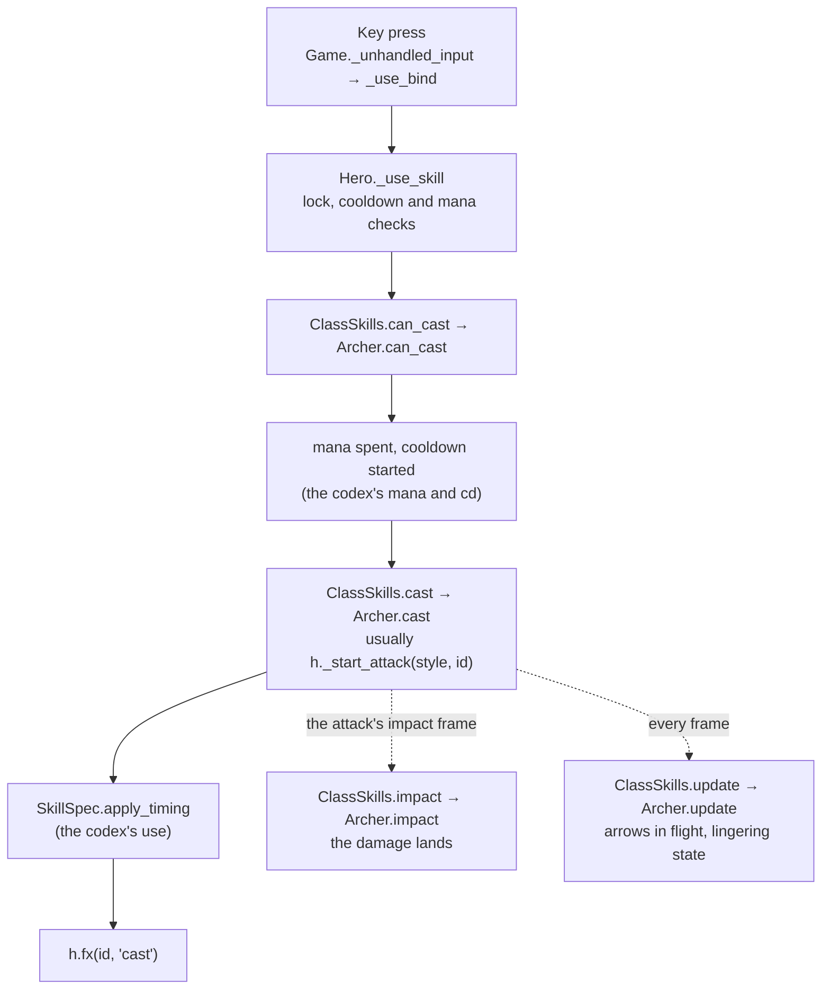

# Skills

A skill is content: Fire Arrow belongs to the Archer. It runs on the skill system, which every skill shares. This doc
covers both halves: what every skill gets, and what you write. The Archer is the example throughout. It is being
rebuilt as the template ([the plan](../architecture_cleanup.md)), and this doc changes with it.

## What every skill gets: the skill system

- **Binding and casting.** `game.gd` maps keys to slots (left and right mouse, Q E R, F G V). `Hero._use_skill` finds
  the skill, checks it is unlocked, off cooldown and affordable, asks the class (`can_cast`), spends the mana, starts
  the cooldown, and calls the class's `cast`.
- **The class script interface** (`scripts/class_skills.gd`). Every hero's skills script has the same static
  functions: `can_cast`, `cast`, `impact` (the attack's impact frame), `update` (every frame), `rooted`, `clear`,
  `died` and `sound`. `ClassSkills.of` routes a skill to its class's script by the skill's `cls`.
- **`SkillSpec`** (`scripts/skill_spec.gd`) is the data-driven part. It reads a skill's optional fields (`use`, `hit`,
  `dmg`, `area`, `dot`, `pvp`…) and gives timing, targets and strikes. The Demon, the shared skills and the dragons
  use most of it. The Archer uses only its timing.
- **Damage, statuses and rite hooks** come from [combat](../systems/combat.md). A skill calls
  `h._hit_enemy(enemy, mult, knock, skill_id)` and never computes armour or crit itself.
- **Drawing** comes from [effects](../systems/effects.md): a skill calls `h.fx(skill_id, event, data)`, and its
  effects handler draws that on every player's screen.

## What you write for a skill

| Piece | Where | The Archer today |
|---|---|---|
| Name, text, mana, cooldown, range, power, timing | its entry in `data/codex/heroes/<hero>.json` ([data](../systems/data.md)) | ✓ for those fields. Its damage multipliers are still constants in `archer.gd`. |
| The class wiring (key, aim, tags) | `Data.SKILLS` | ✓ |
| The rules: `cast`, `impact`, `update` for this skill | `skills/<skill>/<skill>.gd` | all in `archer.gd` (957 lines) |
| The look: its fx events' handlers | `skills/<skill>/<skill>_fx.gd` | `archer_fx.gd`, `skills/thunderstep/thunderstep_fx.gd`, and the shared `scripts/arrow_fx.gd`, `frost_volley_fx.gd`, `arc_fx.gd` |
| Its own models and textures | `skills/<skill>/` | `skills/frost_volley/rain/`, `skills/thunderstep/` |
| What its skills share | `shared/` (one hero) or `game/systems/` (several heroes) | the three shared fx scripts above, still in `scripts/` |
| Icon | `assets/textures/skills/` | ✓ |
| Sound | `tools/audio/spec.py` → `assets/audio/sfx/` | ✓ |
| Its test | `tests/` (each skill's gameplay) | `tests/archer_test.gd` |

A skill folder's scripts are reached by their `class_name`, called from the hero's skills script and fx handler.
There is no folder discovery.

## Designing a skill

- **Damage skills have no cooldown;** mana limits them. A cooldown is for utility, and a skill with one carries a
  utility tag: `movement`, `warcry`, `buff`, `cc`, `trap`, `summon`, `command`, `ultimate` or `sustain`.
  `tools/skill_spec_test.gd` checks this, along with every data field's type and range.
- **Every skill has an answer** (its counterplay), and no button carries more than one hard crowd control.
- **The wind-up is readable.** `hit` is when it lands, as a fraction of `use`: about 0.45 for a quick blow, 0.75 for
  a heavy one. `scripts/skill_spec.gd`'s header lists every field.

## The rules for a skill

1. **Rules never draw.** Everything visible is an fx event, and the handler only draws ([effects](../systems/effects.md)).
2. **Numbers players can see come from the codex.** The tooltip and the game must not disagree.
3. **Damage goes through `_hit_enemy`, and crowd control on players through `PvpStatus`** ([combat](../systems/combat.md)).
4. **State lives on the hero or the skill's own object,** and `clear` and `died` end it.
5. **Its test covers its gameplay**, and `tools/coop_fx_test.gd` checks that a partner sees it and that a replay
   hurts nothing.
6. **Its look meets the quality bar** in [effects](../systems/effects.md), checked from the game camera.

## Improving a skill

- **Numbers or text:** edit the codex (the editor, or the JSON). If the number is still a constant in code, move it
  into the codex first.
- **The look:** change its `_fx.gd`, then re-record the warm-up data (`tools/skill_warm_capture.gd`) and check the
  cost with `tools/skill_perf.sh <class> <skill>`.
- **The rules:** change its rules, run its test, and run a multiplayer test if what it sends changed.
