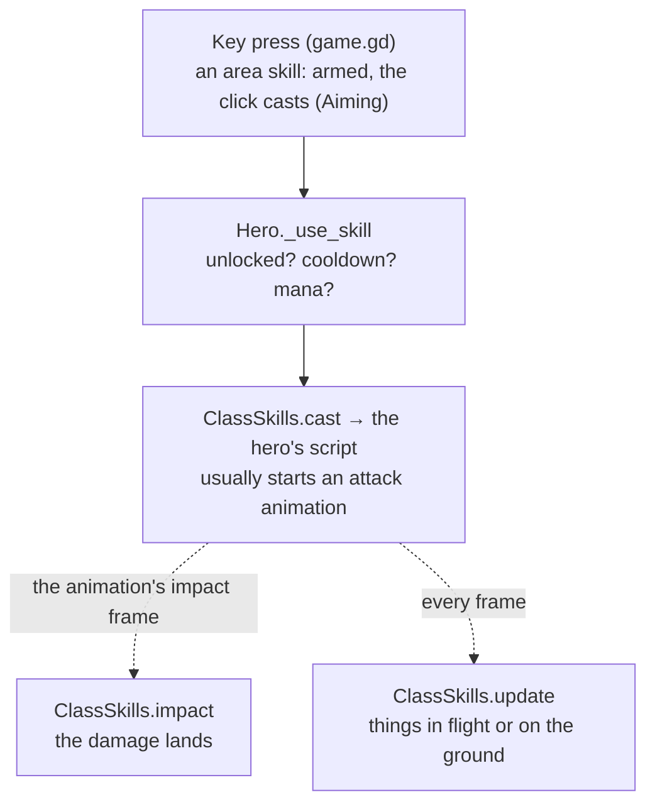

# Skills

A skill belongs to its hero (Fire Arrow is the Archer's) and runs on the skill system every skill shares.

## How a skill runs

- `game/systems/skills/class_skills.gd` routes each call to the hero's skills script, which has the same functions for
  every hero (`can_cast`, `cast`, `impact`, `update`, `rooted`, `clear`, `died`, `sound`), and runs every hero's
  skill objects once a frame (`Skill.update_kit`; a skill whose `late()` is true runs last).
- Mana, cooldown and timing come from the codex. `SkillSpec` (`game/systems/skills/skill_spec.gd`) can also take a skill's
  timing, area and damage from its data.
- Damage goes through `Hero._hit_enemy` ([combat](../systems/combat.md)). What is seen goes through
  `h.fx(skill, event, data)` ([effects](../systems/effects.md)).

## How a hero's skills are built

Every hero follows the Archer's layout (`game/heroes/archer/` is the example; [heroes](heroes.md)).
- **One folder per skill:** `skills/fire_arrow/fire_arrow.gd` is the rules, a `Skill` object
  (`game/systems/skills/skill.gd`) holding its own state and reading its numbers with `val("dmg", 130)`;
  `fire_arrow_fx.gd` is its look; its own models and `sounds/` sit beside them. The hero's script keeps a table of
  which object handles which skill id. What only one hero's skills share goes in its `shared/`.
- **Shared shapes** in `game/systems/skills/`: `Missile` (a projectile's flight and hits), `GroundZone` (ground that
  strikes at a beat) and `DelayedArea` (a spot that goes off after a fuse). They are plain data, with no nodes, so the
  server runs them.
- **The look keeps its own copy.** The rules send one event (an arrow's "loose"), and every game's look draws its own
  copy from it. The look never makes game state.
- **It runs on the server in a match.** A skill creates what its rules act on with `make(kind, data)`: in single
  player and co-op it makes it at once (`made`); in a match it goes to the server, whose copy of the hero checks it
  (`server_ok`: near where it has the hero, within the skill's numbers) and makes it there (`ServerRules`). So
  `made`, `update` and the hits are the rules, and they only ever run where the hits are decided; whatever the rules
  show (a sigil blowing) the server sends to every game. A foe the player's game picked travels as an id
  (`Skill.make_aimed`, read back on the server with `named_foes` / `named_foe`). Target searches use `foe(e)`, which passes by the
  player's own side. What the rules give the hero (life, mana, a cooldown back) goes through `give` / `gain_life`,
  since the player's game owns them. A held channel (Drain Life, Frost Breath) sends "latch" and "end", and the
  server deals each beat. The plain weapon swing goes to the server the same way (`Hero._send_swing`).
- **Summons** (the Archer's wolf, `companion/spirit_beast.gd`) have their own brain: every game runs a copy so it's
  seen, and only the one where the hero's hits are decided bites and can be hurt (`SpiritBeast._deals`); the server's
  copies are kept by the hero's `server_update`.
- **Click to cast.** A skill whose area lands on the aimed spot has `"aoe"` in its codex entry: `{"r": the radius
  key in its "k", "grow": a rite key that widens it}`, never a copy of the number. Its key arms it (`Aiming`,
  `game/systems/skills/aiming.gd`), `AimIndicator` (`game/ui/hud/`) shows its range and where it lands, and the left
  click casts it. Quick cast (the pause menu) casts it on the key.

## Designing a skill

- **It builds toward a direction.** Each hero has a few directions, the build themes in `RunTalents.THEMES` (the
  Archer: Flame, Frost, Storm and Hunt). Every skill feeds one of them, and its rites and gems make that direction
  stronger, so a run grows into a build. Together, a direction's skills should make the hero play in a way nothing
  else does: a Frost Archer and a Storm Archer should feel like different characters. A skill that serves no
  direction doesn't belong on the hero.
- **Good models.** Whatever a skill puts in the world (an arrow, a totem, a summon, a weapon) is a real model made
  for it ([assets](../pipeline/assets.md)), never a stack of primitives, and its look meets the bar in
  [effects](../systems/effects.md).
- **It's cheap.** Every copy of the hero draws it, so four players casting costs four times as much. Free what's
  done, share materials, keep lights and particles few, and measure it with `tools/skill_perf.sh <class> <skill>`
  before it ships ([performance](../systems/performance_kpis.md)).
- **Every skill has an answer** (its counterplay), and no button carries more than one hard crowd control.
- **The wind-up is readable:** a heavy blow lands later in its animation than a quick one.
- `tools/skill_spec_test.gd` checks every data field.

## Changing a skill

- **Numbers or text:** the codex ([data](../systems/data.md)).
- **The look:** its effects script. Check it from the game camera, and its cost with
  `tools/skill_perf.sh <class> <skill>`.
- **The rules:** its script, then its hero's tests, and a multiplayer test if what it sends changed.
