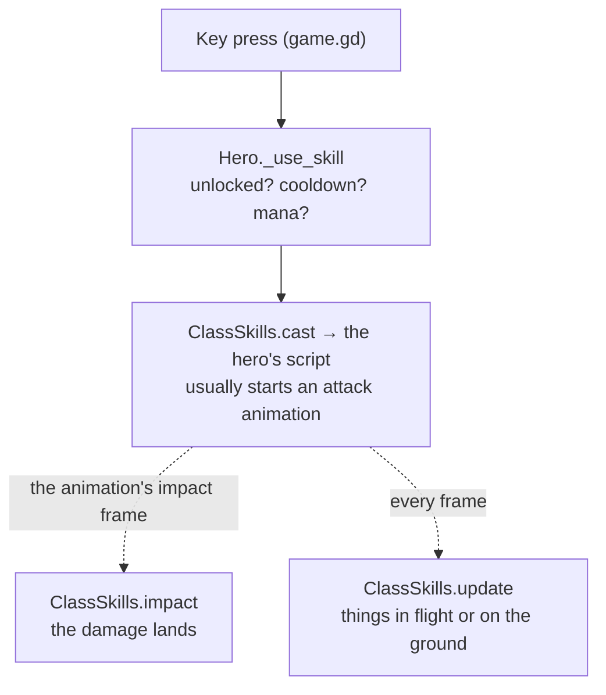

# Skills

A skill belongs to its hero (Fire Arrow is the Archer's) and runs on the skill system every skill shares.

## How a skill runs

- `scripts/class_skills.gd` routes each call to the hero's skills script, which has the same functions for every hero
  (`can_cast`, `cast`, `impact`, `update`, `rooted`, `clear`, `died`, `sound`).
- Mana, cooldown and timing come from the codex. `SkillSpec` (`scripts/skill_spec.gd`) can also take a skill's
  timing, area and damage from its data.
- Damage goes through `Hero._hit_enemy` ([combat](../systems/combat.md)). What is seen goes through
  `h.fx(skill, event, data)` ([effects](../systems/effects.md)).

## How the Archer's skills are built

The Archer is the example to copy. Most other heroes still keep every skill in one script.
- **One folder per skill:** `game/heroes/archer/skills/fire_arrow/fire_arrow.gd` is the rules, a `Skill` object
  (`game/systems/skills/skill.gd`) holding its own state and reading its numbers with `val("dmg", 130)`.
  `archer.gd` keeps a table of which object handles which skill id.
- **Shared shapes** in `game/systems/skills/`: `Missile` (a projectile's flight and hits) and `GroundZone` (ground
  that strikes at a beat). They are plain data, with no nodes, so a server could run them.
- **The look keeps its own copy.** The rules send one event (an arrow's "loose"), and every game's look flies its own
  arrow from it with the same `Missile` step (`shared/arrow_flight_fx.gd`). The look never makes game state.
- Thunderstep, Spirit Beast and Hunter's Mark are still in `archer.gd`.

## Designing a skill

- **Damage skills have no cooldown;** mana limits them. A skill with a cooldown carries a utility tag (`movement`,
  `cc`, `buff`, `summon`…). `tools/skill_spec_test.gd` checks this and every data field.
- **Every skill has an answer** (its counterplay), and no button carries more than one hard crowd control.
- **The wind-up is readable:** a heavy blow lands later in its animation than a quick one.

## Changing a skill

- **Numbers or text:** the codex ([data](../systems/data.md)).
- **The look:** its effects script. Check it from the game camera, and its cost with
  `tools/skill_perf.sh <class> <skill>`.
- **The rules:** its script, then its hero's tests, and a multiplayer test if what it sends changed.
