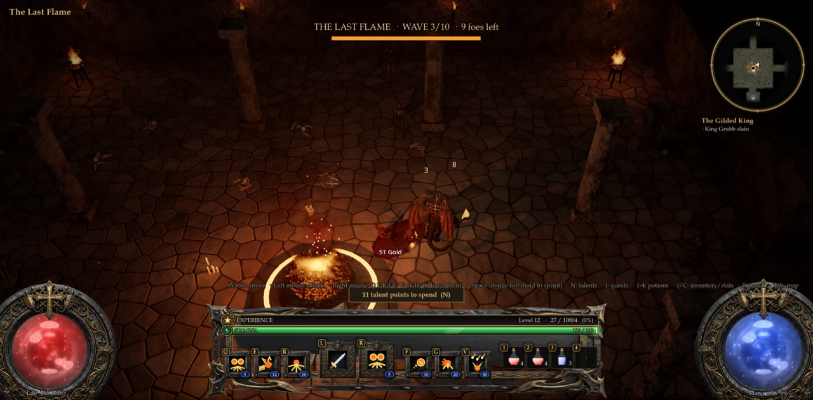

# The Last Flame

**Pitch:** hold the last fire in the dark against ten waves of the dead, together.

## The concept, and why

A co-op horde defence. Under the Act I camp is a sunken sanctum with a great fire on a stone altar; the dark comes
through three breaches (north, east, west) in ten escalating waves, and the party holds the flame. The monsters go
**for the flame**, not for you, unless you stand closer than the flame is: so the game is interception. Who takes the
north breach, who peels the archers shooting the fire from range, when to dash back because the bar is dropping.
Between waves the flame mends a little and gold lies by it; clicking it with a log you chopped on the moor feeds it.
Wave 5 and wave 10 bring a named champion (with a boss bar on everyone's screen), wave 8 the Forsaken Bear.

Why this one, on the first mode night (no feedback yet to build on):
- **It's for two friends playing together.** With two players, PvE co-op gives you something to talk about
  ("I've got north!"); a two-person PvP match in the Hollow Crypt is over fast. It's the opposite of the Crypt, and
  the two sit well side by side.
- **It runs on the online co-op server that already exists** (`ashen-crown-coop`, UDP 24570, already open in the
  staging firewall), so there's nothing new to set up on the server: the nightly deploy restarts it with this code.
  A new Battlegrounds-style server would have needed a new port opened in the DigitalOcean firewall and a new
  systemd service, which isn't safe to do unattended.
- **Everything is reused**: the crypt shell, pillars, torches, sarcophagi, the simulated bonfire, portals, the Act I
  monsters (Fallen ×3, zombies, bone archers, the Forsaken Bear), the sounds (arena horn, roar, bonfire whoosh).
  No new assets were bought.
- **It's safe.** These are your own characters with no loss on death: you rise by the altar. The loot and
  experience are real, so it's worth playing again.

## How to play (from the title screen)

1. Both players, on the itch staging build: have a character (make one if you have none, then Save and Exit to
   Title), then click **Online Co-op** on the title screen. It joins the staging co-op server with the character you
   played last. You both arrive in the Act I camp, the Forsaken Wilds.
   (Playing on the same LAN works too: one hosts, the other joins. So does playing alone.)
2. Walk to the **orange portal between two dark standing stones**, inside the palisade south-east of the bonfire
   (hover: "The Last Flame (co-op waves)"). Click it. Your partner gets the ready check: **Join**.
3. You arrive in the sanctum. The HUD at the top says *"click the flame to begin the vigil (10 waves)"*. Click the
   altar's fire.
4. The waves start 6 seconds later. Hold the flame for all ten.
5. The blue portal in the south vestibule (behind where you arrived) leads back to the camp.

## Rules

- **Ten waves.** A wave ends when all of its monsters are dead; the HUD shows `WAVE n/10 · x foes left` and the
  flame's life bar. 12 s between waves.
- **Monsters target the flame** unless a hero is nearer to them than the flame is. Bone archers shoot it from range.
- **The flame**: its life scales with the party's average level and with the number of players. A wave held gives
  back 15% of it. The fire burns lower as it's hurt.
- **Feeding**: click the flame with a log in your bag (during a vigil) to burn it: oak +8%, pine +5%,
  Ashen Heartwood +25%. Chop trees on the moor first (you need an axe; every hero has the woodsman's axe).
- **Scaling**: each extra player brings 55% more monsters and 55% more flame. The monsters' level is the party's
  average level, plus 1 every three waves.
- **Rewards**: every wave, gold for each player by the flame; every other wave (and wave 5), an item; holding all
  ten, a unique each and a heap of gold. Every kill gives normal experience and drops.
- **Death**: you rise by the altar after the death screen (10% of your gold, as everywhere). Nothing is lost.
- **Losing**: the flame goes out, the wave crumbles to ash (no experience for it), and after 14 s the flame burns
  again: click it to try again.
- **Controls**: the game's usual ones (WASD, left click attack, right click and Q E R F G V skills, Space to dodge,
  1-4 potions, T town portal).

## What was built

| File | What |
|---|---|
| `scripts/vigil.gd` (new) | The zone (`Vigil.build`), the flame as a monster target (`Vigil.Flame`), the host's wave machine, rewards, feeding, events, the HUD |
| `scripts/world.gd` | `"vigil"` in the zone builder |
| `scripts/game.gd` | The zone's title, indoor light, interactions (gate, altar, feeding, exit), respawn by the altar |
| `scripts/net.gd` | Six RPCs: `cl_vigil` (state), `cl_vigil_fx` (events), `sv_vigil` (kindle), `sv_vigil_feed`, `sv_vigil_hi` (a player's level) |
| `scripts/forest_camp.gd` | The Vigil Gate in the camp (portal and two stones, no extra lights: the camp is a benchmark scene) and its arrival spot |
| `scripts/projectile.gd` | Monster missiles also hit the `"objective"` group (the flame) |
| `tools/nightly_vigil_test.gd` (new) | The solo test (in the nightly gate) |
| `tools/vigil_coop_test.gd` (new) | The co-op server and two players |
| `tools/vigil_sim.gd` (new) | Balance probe: a bot defends alone |
| `tools/vigil_shots.gd` (new) | Screenshots and GIF frames |
| `CLAUDE.md` | "The Last Flame" section and code map row |

## Tests

- `tools/nightly_vigil_test.gd`: **41/41 ok**. The gate in the camp leads down; the sanctum, altar and exit are
  built; every breach has a path to the altar; wave 1's monsters walk to the flame and hurt it while the hero stays
  away; all ten waves cleared, with champions on 5 and 10 and their boss bars; gold, a unique and experience; the
  flame relights; a bone archer's arrow hurts the flame; feeding an oak log (+8%) and nothing without one; a second vigil lost: the flame goes out and the
  wave crumbles with no experience; a death rises by the altar; the portal back to the camp.
- `tools/vigil_coop_test.gd` (the co-op server + two players): **server 9/9, a 9/9, b 8/8 ok**. Both join the server's
  camp, a steps through the gate, b answers the ready check, both arrive, a kindles it (the server runs it), wave 1
  is scaled for two (9 monsters instead of 6), both levels are known to the server, both see the state and the HUD,
  and together they hold wave 1.
- Regression: `playtest`, `coop_fx_test`, `title_test`, `bg_test` (server + client), `mp_test` (host + join) all
  green (mp_test's `[H4] partner pos ok=false` line is the same on staging before this change).

## Known issues

- Only tested with bots. The balance (flame life, counts, levels) is a first guess checked by `tools/vigil_sim.gd`
  (see below); it may be too easy for strong characters or too hard for a new level-1 one alone.
- The flame isn't solid (heroes can walk through the altar), so that archers keep a line of sight to it.
- Only one vigil runs per zone: on the co-op server everyone there plays the same one (that's the point, but a
  third player joining mid-vigil arrives in it).
- No new music: the sanctum plays the game's synthesized drone for zones without a song.
- No best-wave record is saved yet.
- The Vigil Gate is only in the Act I camp (A2 and A3 keep the old camp).

## Balance probe

`tools/vigil_sim.gd`: one bot alone, starter gear, no talents, basic attacks only (no skills, no dodging), always
going for the monster nearest the flame, breaks cut to 2 s. Monsters are the party's average level minus 2, +1 every
three waves.

| Bot | Result | Deaths |
|---|---|---|
| Knight, level 5 | lost at wave 7 (10 min) | 14 |
| Wraith, level 8 | lost at wave 5 (6.5 min) | 20 |
| Knight, level 15 (before the minus 2) | 3 deaths in wave 1: monsters at the party's own level were too much for starter gear, hence the minus 2 | |

So one dumb bot doesn't get far. Two real players with skills, potions and gear should get much further, and
holding all ten should be hard work. That's the number to tune from your feedback (`FLAME_LIFE`, `WAVES`,
`PER_PLAYER` at the top of `scripts/vigil.gd`).

## Cost

- Meshy: **0 credits** (no new models).
- ElevenLabs: **0 credits** (no new sounds; reused the arena horn, roars, the bonfire whoosh, the burn sound).
- (The nightly script adds the Claude cost.)
