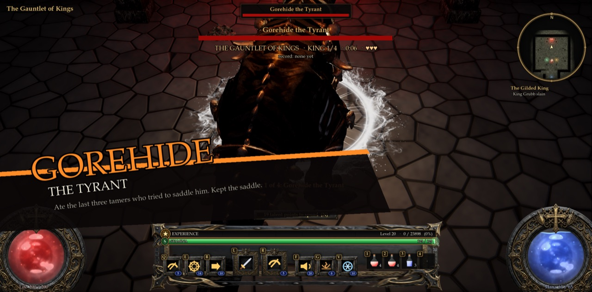
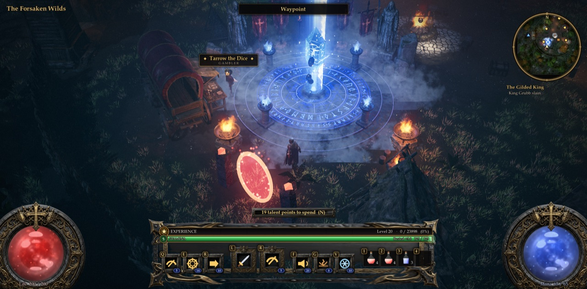
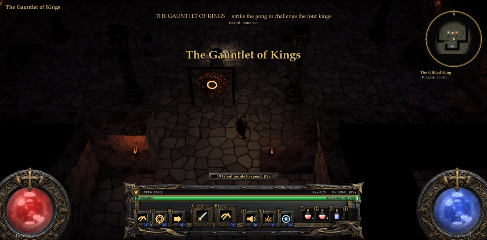
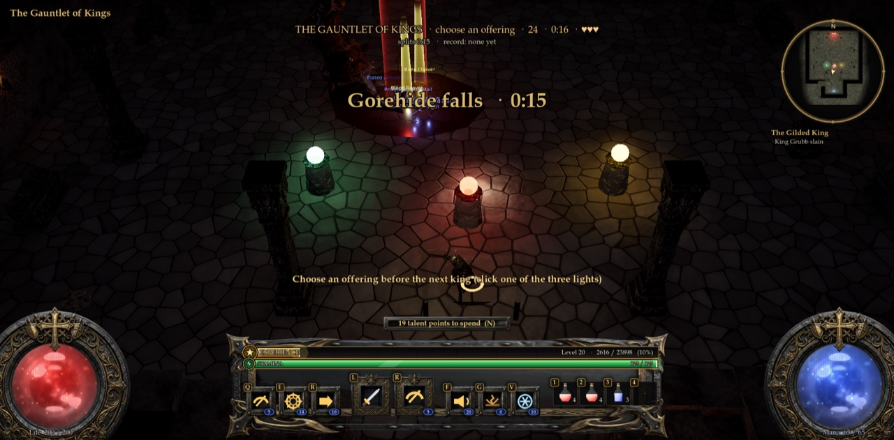
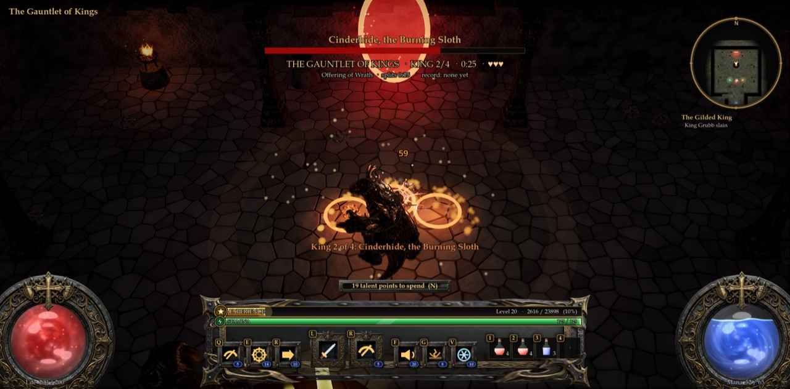
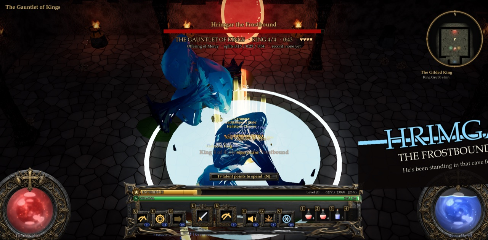

# The Gauntlet of Kings

**Pitch:** four of the game's bosses back to back, one clock, a few shared lives; between fights the party picks
Mercy, Wrath or Greed. Beat the hall's record.

| | |
|---|---|
|  |  |
|  |  |
|  | |

## The concept, and why

A co-op **boss rush**. Under the Act I camp is a sunken throne hall. Strike the Gong of Challenge and four kings come
through the Throne Gate one after another, each with the fight it has elsewhere in the game:

1. **Gorehide the Tyrant** (the island's T-rex): charges, roars, mauls (and his comic-book intro card).
2. **Cinderhide, the Burning Sloth** (Act I's fire Sloth): sweeps that throw you back, the Earthshaker slam, the
   pounce, burning ground everywhere.
3. **Old Mossbeard** (the Crypt's third floor): poison bolts, mushrooms bursting up round you that breathe poison until
   you cut them down, root snares, the Spore Step, thorns.
4. **Hrimgar the Frostbound** (the Crypt's second floor): the Glacial Slam ring, Frost Lances, the Rime Roar, and the
   Avalanche when he's hurt.

One clock runs from the gong to the last king. The party **shares lives** (3, +1 per extra player): every fall spends
one, the fallen rise at the hall's door and run back in, and a fall with none left ends the run. Between kings the
party has 25 s to take **one offering** of three, and the first one clicked counts, which is the decision two players argue
about:

- **Mercy**: everyone healed to full (life and mana), and the party gets a life back.
- **Wrath**: the next king comes in wounded (30% of its life gone).
- **Greed**: the next king is stronger (+35% life, +15% damage), but drops a hoard (gold and good items for each player).

Kill all four for a unique each and a heap of gold, and the hall keeps the **record time** (who set it, and how many
times they were greedy). The record is the server's: the fastest pair on staging is on everyone's HUD.

Why this one:
- **No feedback yet** on last night's Last Flame (a horde defence), so tonight is the other big co-op shape: **bosses**.
  The game's best fights already exist (four bosses with telegraphs, intro cards and their own brains), but each sits
  in its own corner (an island, the moor, two crypt floors you can only reach in a hardcore raid). The Gauntlet puts
  them in one room for two friends, with no risk to their characters.
- **Something to have an opinion about**: the clock, the shared lives and the offering choice between fights
  ("Greed, we've got this" / "no, Mercy, I'm on fumes").
- **It runs on the online co-op server that already exists** (`ashen-crown-coop`, UDP 24570, open in the staging
  firewall): nothing new to set up; the nightly deploy restarts it with this code.
- **Almost everything is reused**: the four bosses, the crypt kit (walls, pillars, torches, sarcophagi, bones), the
  portal model, braziers, the boss intro cards and life bar, sounds. One new sound: the gong (ElevenLabs, 120 credits).

## How to play (from the title screen)

1. Both players, on the itch staging build: have a character (create one if you have none; the fight scales to your
   average level, so any level works, but 10+ with real gear is more fun). Click **Online Co-op** on the title screen.
   You both arrive in the Act I camp (the Forsaken Wilds).
   (LAN co-op works too: one hosts, the other joins. So does playing alone.)
2. Walk to the **crimson portal between two dark standing stones**, inside the palisade **south-west of the bonfire**
   (the Last Flame's orange portal is its mirror image in the south-east). Hover: "The Gauntlet of Kings (co-op boss
   rush)". Click it; your partner gets the ready check: **Join**.
3. You arrive at the hall's door. Walk in: the **Gong of Challenge** stands in front of you. Click it.
4. Five seconds later the first king comes through the red Throne Gate at the far end. Kill it.
5. Three lights glow on pedestals south of the floor: **click one** (green Mercy, red Wrath, gold Greed). 25 s to choose;
   no choice = no offering.
6. Repeat for all four kings. The blue portal behind the door leads back to the camp.

## Rules

- **Four kings**, always in the same order. Each comes at the party's average level minus 1; its life is scaled for
  the number of players (+60% per extra player) and evened out so each fight takes about as long as the last.
- **Lives**: 3, +1 for each extra player (4 for two). A fall spends one ("A life is spent: 3 left"); at none the HUD
  warns you, and the next fall ends the run: the king crumbles (no loot or experience for it).
- **The fallen** rise at the hall's door after the death screen (10% of your gold, as everywhere) and run back in.
- **Offerings**: one per gap between kings (three in a run), first click wins, the HUD and a message say who chose what.
- **Rewards**: each king drops its usual boss loot (the T-rex, Hrimgar and Mossbeard their 7 boss drops, Hrimgar and
  Mossbeard a class unique, Cinderhide its unique and its Cinderheart material) and normal experience. All four: a
  unique and gold each. Greed: 3 gold piles and 2 good items per player more.
- **The record**: the server keeps the hall's best time on disk (`user://gauntlet_record.json`); everyone in the hall
  sees it under the clock with the splits of the current run.
- **Leaving**: if everyone leaves the hall mid-run, it resets.
- **Controls**: the game's usual ones (WASD, left click attack, right click and Q E R F G V skills, Space to dodge:
  you will need it, 1-4 potions, T town portal).

## What was built

| File | What |
|---|---|
| `scripts/gauntlet.gd` (new) | The zone (`Gauntlet.build`: the hall, the Throne Gate, the gong, three offerings, four trophy braziers lit as each king falls), the host's run (kings, lives, offerings, clock, splits, record), events, the HUD |
| `scripts/world.gd` | `"gauntlet"` in the zone builder |
| `scripts/game.gd` | The zone's title and indoor light, interactions (gate, gong, offerings, exit), respawn at the door, a king's death isn't the act's victory (no portal, victory screen or `boss_killed`) |
| `scripts/net.gd` | Three RPCs: `cl_gauntlet` (state), `cl_gauntlet_fx` (events), `sv_gauntlet` (a partner's gong / offering and level) |
| `scripts/forest_camp.gd` | The Gauntlet Gate in the camp (a crimson portal and two stones, no lights: the camp is a benchmark scene) and its arrival spot |
| `assets/audio/sfx/gauntlet_gong_*.wav` (new) | The gong (ElevenLabs, two takes; `tools/audio/spec.py`, `scripts/sfx_bank.gd`, `assets/audio/CREDITS.md`) |
| `tools/nightly_gauntlet_test.gd` (new) | The solo test (in the nightly gate) |
| `tools/gauntlet_coop_test.gd` (new) | The co-op server and two players |
| `tools/gauntlet_sim.gd` (new) | Balance probe: a bot runs the gauntlet alone |
| `tools/gauntlet_shots.gd` (new) | Screenshots and GIF frames |
| `CLAUDE.md` | "The Gauntlet of Kings" section and code map row |

## Tests

- `tools/nightly_gauntlet_test.gd`: **57/57 ok**. The camp's gate (open ground, reachable, the Vigil Gate still there)
  leads down; the hall, gong, offerings and exit are built and the Throne Gate reaches the floor; no offering before a
  run; the gong starts it (3 lives), a second strike does nothing; Gorehide comes, his life bar is up, he notices and
  hurts the hero, the clock runs; his fall opens the offerings, keeps the split, gives experience, lights the trophy,
  isn't the act's victory; Wrath brings Cinderhide in at 70% (her life bar up, she hunts), one offering per king;
  Greed brings Mossbeard at x1.35 life, his mushrooms come and wither with him, the hoard lies where he fell; Mercy
  heals and gives a life back; Hrimgar falls: the run is won, the record set and saved, a unique dropped, every
  trophy lit, the gong ready again; a second run is lost on a fall with no lives left (the king crumbles, no
  experience), the fallen rise at the door; the portal leads back to the camp by the gate.
- `tools/gauntlet_coop_test.gd` (the co-op server + two players): **server 13/13, a 14/14, b 13/13 ok**. Both join the
  server's camp, a takes the gate, b answers the ready check, both arrive, a strikes the gong (the server runs it: 4
  lives for two, the king's life x1.6), both levels are known, both see Gorehide come with his life bar, his life and
  the HUD, beat him together, b takes Wrath (the server applies it), both see Cinderhide come wounded, and the hall
  resets when they leave.
- `tools/nightly_vigil_test.gd` (last night's mode, which shares the camp): 0 failed.
- Regression: `playtest` (all steps through the boss, victory, save and death), `coop_fx_test` (0 failed; its
  `class_skills.gd` "Nonexistent function update/rooted" script errors come from code this change doesn't touch),
  `title_test` (all true), `bg_test` (server 0 failed, client 0 failed), `mp_test` host + join (all through; its
  `[H4] partner pos ok=false` line is the same on staging before this change, as the Last Flame's notes say).

## Balance probe

`tools/gauntlet_sim.gd`: one bot alone, no offerings, standing at the king and swinging, its class's first skills when
it has the mana, a potion under 40%, rising at the door 3 s after a fall. **It never dodges or steps out of a
telegraph**, so this is the worst case.

| Bot (alone) | Result | Kings' times | Falls |
|---|---|---|---|
| Plague Doctor, level 14, "Go to level 20" gear | 3 of 4 kings, lost to Hrimgar at 2:38 | Gorehide 35 s, Cinderhide 32 s, Mossbeard 55 s | 3 (+1) |
| Demon, level 20, geared | 2 of 4, lost to Mossbeard at 2:22 | 33 s, 37 s | 3 (+1) |
| Knight, level 20, geared | 2 of 4, lost to Mossbeard at 2:49 | 51 s, 49 s | 3 (+1) |
| Knight, level 10, starter gear, no talents | 0 of 4: Gorehide (2,422 life) outlasts him | | 3 (+1) |

(Before tonight's last tuning the kings were at the party's level with 0.85 of their blows; a geared level-20 knight
then lost 3 lives to Cinderhide alone. After these runs Mossbeard's mushrooms were also given the kings' 0.7.) So
a pair of real players who dodge, use the offerings (Mercy = a life back) and have 4 lives between them should clear
it with work, in about 4-6 minutes; a fresh low-level character will struggle (the fights scale to the level, the starter
gear doesn't).

The kings' numbers to tune from your feedback are at the top of `scripts/gauntlet.gd`: `KINGS` (each king's life),
`DMG` (their blows, 0.7), `LEVEL_UNDER` (1), `LIVES` (3), `PER_PLAYER` (0.6), and the offerings `WRATH`, `GREED_LIFE`,
`GREED_DMG`.

## Known issues

- Only tested with bots. The balance is a first guess; the bots (no dodging) find Cinderhide and Mossbeard hard.
- A partner who arrives in the middle of a fight sees the king's life bar but computes its maximum from the unscaled
  life (the bar can read full for a while); everyone who comes in through the ready check is fine.
- One run per hall: on the co-op server everyone in the hall plays the same run (a third player joining mid-run arrives
  in it and adds no lives).
- The record is the host's: on the staging co-op server it's shared by everyone; in a LAN or solo game it's that PC's.
- No new music: the hall plays the game's drone for zones without a song.
- The Gauntlet Gate is only in the Act I camp (A2 and A3 keep the old camp).
- Kings drop their loot where they die, often at the far end by the Throne Gate.

## Cost

- Meshy: **0 credits** (no new models: every king and prop is reused).
- ElevenLabs: **120 credits** (three 4 s takes of `gauntlet_gong`, 40 each; the top two by `score.py` are in the game).
- (The nightly script adds the Claude cost.)

### Build cost (filled in by the nightly script)

| Tool | Cost |
|---|---|
| Claude (this mode, 1 turns, 0.0 min) | $10.27 |
| Meshy | 0 credits |
| ElevenLabs | 120 credits |
| Staging server (share of the night) | $0.27 |
