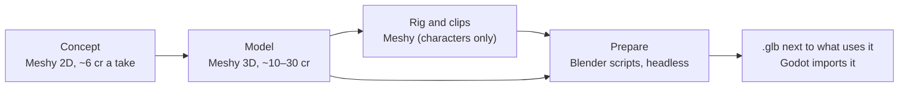

# Assets: Meshy → Blender → Godot

Everything new that players see is a real made asset (a Meshy model, a simulated effect, a recorded sound), judged
in the game's own renderer from the game camera. Placeholder shapes and recoloured generic bursts aren't finished.

## The route

1. **Concept** with `tools/meshy/meshy.py draw` or `edit`. For anything an admin chooses between, make three takes.
2. **Model:** image-to-3D from the concept for anything whose shape matters; text-to-3D only for simple props.
3. **Prepare in Blender** with the script for the kind of thing: props `tools/blender/prep_prop.py`, heroes a
   `build/prep_*_mocap.py`, monsters `tools/blender/act1/prep_monster.py`. Check it beside a man-sized post with
   `tools/blender/prop_sheet.py`. The `.blend` stays outside the repo.
4. **Export** the `.glb` next to what uses it (a hero's `body/`, a skill's folder). Godot imports it on the next open.
5. **Effects** are simulations (Blender fire, smoke and liquid rendered to flipbooks) and real fractured pieces
   ([effects](../systems/effects.md)).
6. **Icons** are Meshy-painted grids cut by `tools/skill_icons.py` and `tools/talent_icons.py`.
7. **Sound** is ElevenLabs through `tools/audio/` (a human picks the takes), never synthesized.

## Keep it cheap

- Budgets: props about 10k triangles with 1k textures, monsters about 20k, heroes 50–60k.
- Load models during play through `ResCache` ([loading](../systems/loading.md)), and check a new skill's cost with
  `tools/skill_perf.sh <class> <skill>`.

## Spending

- Either admin's request covers existing Meshy and ElevenLabs credits. Subscriptions, upgrades and top-ups need an
  explicit spending request.
- Record each paid job's id, and resume a pending job instead of paying twice.
- A downloaded model needs its source, author and licence recorded beside it.
