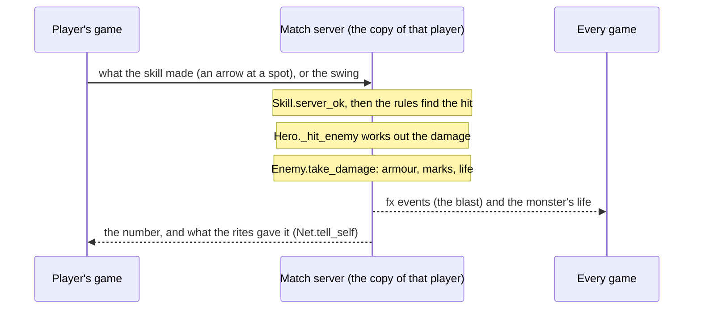

# Combat

How a hit becomes damage, and who decides it.

## A hit

- The rules find what a skill hit on the game that decides the hero's hits (the match server in a match; the
  player's own game in single player and co-op) and call `Hero._hit_enemy(e, mult, knock, src)` (`game/heroes/hero.gd`).
  That rolls the weapon's damage, crit, rites and buffs, and the skill's own power.
- `Enemy.take_damage` (`game/monsters/enemy.gd`) applies armour and marks. In co-op the monster on a player's game is a copy,
  so the numbers go to the host (`Net.sv_enemy_hit`), which applies them.
- **Monsters** run only on the host or match server. Their hits on a player are applied by that player's own game
  (`Hero.take_hit`).
- **PvP:** other players are invisible `Enemy` stand-ins (the match server keeps its own for every player). A blow on
  one goes to `Battlegrounds.pvp_hit`, which checks the pair (no teammates) and scales it.

## Statuses

- **Monsters** carry burn, chill, stun and slow, and tags such as Hunter's Mark, in `enemy.gd`.
- **Players** take crowd control through `PvpStatus` (`game/systems/combat/pvp_status.gd`): stagger (a stun), knockup, pull,
  fear, slow, burn and more. The server checks it, and hard crowd control has diminishing returns. New crowd control
  on players goes through `PvpStatus`.

## Rites and gems

Rites and gems live in `game/items/`: their tables in `rites/rites.gd` and `gems/gems.gd`, when a proc fires in
`rites/rite_procs.gd`, what it does to foes in `rites/proc_hits.gd`, and its look in `rites/rite_fx.gd`. Combat calls
them through `RunTalents` (`game/items/run_talents.gd`) at fixed points: before and after a
hit (`hit_mult`, `on_hit`), on a kill, when struck, on a cooldown, every frame, and on a shot. Their procs fire only
where the hero's hits are decided (`Hero.decides`).

## Who decides

In a Battlegrounds, Arena or Sandbox match, **every hero's skills and weapon swings run on the match server**
(`game/systems/skills/server_rules.gd`). A player's game sends what a skill makes (an arrow, a pool, a sigil, a
swing); the server's copy of that player checks it against where it has them and what the skill allows
(`Skill.server_ok`), makes it, decides who it hits with its own positions and its own stand-ins for players, and deals
the damage from the build the game sends it (level, attributes, the run's skills, rites and gems). Rites fire there
too (`Hero.decides`); what they do to the player (life back, a buff, a cooldown) goes back to their game
(`Net.tell_self`). Flasks and thorns go through the server the same way. A summon (the Archer's wolf) bites on the
server; every game runs a copy that is only seen.

Still on the player's game, and trusted by the server for now: their own life, movement, cooldowns and mana, buffs
and wards on themselves (War Cry, Aegis, Transfusion, the Fog), and the blows counted on their things in PvP (a
Corpse Bloom). Single player and Enter World co-op decide everything on the player's (or the host's) game. There is
no combat log yet.
