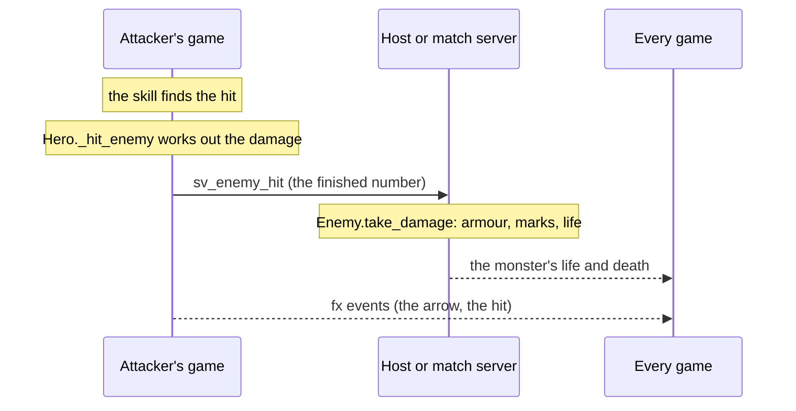

# Combat

How a hit becomes damage, and who decides it.

## A hit

- A skill finds what it hit on the attacker's game and calls `Hero._hit_enemy(e, mult, knock, src)`
  (`scripts/hero.gd`). That rolls the weapon's damage, crit, rites and buffs, and the skill's own power.
- `Enemy.take_damage` (`scripts/enemy.gd`) applies armour and marks. On a player's game the monster is a copy, so the
  numbers go to the host (`Net.sv_enemy_hit`), which applies them.
- **Monsters** run only on the host. Their hits on a player are applied by that player's own game (`Hero.take_hit`).
- **PvP:** other players are invisible `Enemy` stand-ins. A hit sends the attacker's number to the server
  (`Net.sv_pvp_hit` → `Battlegrounds.pvp_hit`), which checks the pair and scales it.

## Statuses

- **Monsters** carry burn, chill, stun and slow, and tags such as Hunter's Mark, in `enemy.gd`.
- **Players** take crowd control through `PvpStatus` (`scripts/pvp_status.gd`): stagger (a stun), knockup, pull,
  fear, slow, burn and more. The server checks it, and hard crowd control has diminishing returns. New crowd control
  on players goes through `PvpStatus`.

## Rites and gems

`scripts/run_talents.gd` holds what rites and gems do. They hook into combat at fixed points: before and after a
hit (`hit_mult`, `on_hit`), on a kill, when struck, on a cooldown, every frame, and on a shot.

## Who decides

Today each player's game decides its own hero's damage, cooldowns and mana, and the server trusts it (PvP numbers
are clamped). The host or match server decides monsters, deaths and loot. Moving damage onto the server, with a
combat log of every hit, is the next big piece of work. Until then there is no combat log.
