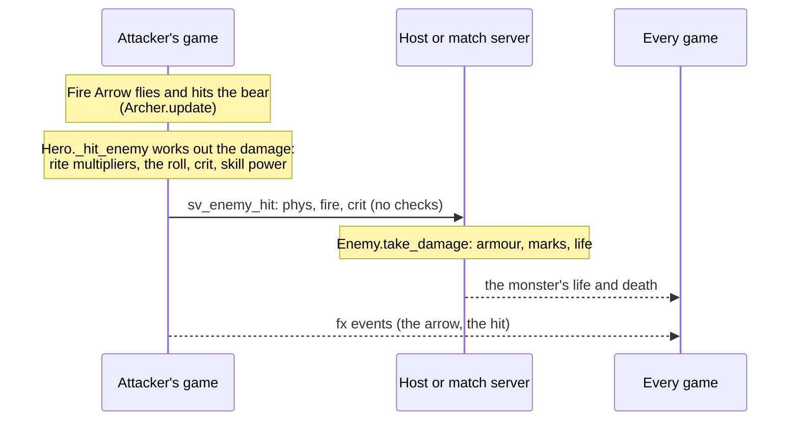

# Combat

How a hit becomes damage, where statuses, rites and gems come in, and who decides each part. The section "What's
changing" says what the combat work will change. Everything else describes the code as it is today.

## A hit on a monster, today

1. **The skill finds the hit on the attacker's game.** For example, `Archer.update` flies the arrow, and a hit calls
   `Hero._hit_enemy(e, mult, knock, src, flat)` (`scripts/hero.gd`).
2. **`Hero._hit_enemy` works out the number:**
   - rite and gem multipliers (`RunTalents.hit_mult`);
   - `roll_damage`: weapon damage times buffs, crit 5% + dex × 0.15% + crit rites, a crit deals ×(2 + crit damage);
   - `dmg_mult`: the skill's `power` from its data, damage rites, `pace_mult` (the class's attack pace), and
     `RunBuild.CLASS_POWER` in a run.
3. **`Enemy.take_damage`** (`scripts/enemy.gd`) applies armour (`phys × 100 / (100 + armour × 0.6)`) and marks such
   as Hunter's Mark (+35%). On a player's game the monster is a remote copy, so it sends the raw numbers to the host
   (`Net.send_enemy_hit` → `sv_enemy_hit`), shows the number, and stops. The host runs `take_damage` again, for real.
4. **After the hit,** `RunTalents.on_hit` runs the rites (`on_death` when it dies).

## A hit on a player, today

- **Monsters.** Monster brains run only on the host (a remote copy returns early). A monster's attack on another
  player's puppet (their `Hero` on the host's game) becomes `Net.hit_player` → `cl_take_hit`, and the victim's own game applies it in `Hero.take_hit`:
  dodge, block, armour or resistance, wards, life, death. Each player's life belongs to their own game and is shared
  in the state packet.
- **PvP.** Other players are invisible `Enemy` stand-ins with a `pvp_pid`. A hit on one sends `send_pvp_hit` (the
  attacker's finished number) → `sv_pvp_hit`. The server's `Battlegrounds.pvp_hit` checks the pair (`pvp_pair`: the
  raid is on, two different living players, at most 30 m apart; the Arena adds teams and the fight phase), then
  sends `clamp(amount, 0, 5000) × PVP_MULT (0.6) × Data.pvp_scale` to the victim as physical damage.

## Statuses, today

| On | Where | What exists |
|---|---|---|
| Monsters | `enemy.gd` | Burn (`ignite`) and chill tick on every game. The host applies chill (`sv_enemy_chill`), stun and slow (`sv_enemy_stun`; a slow is a negative time). Tags such as `hunted_until`, `brand`, `deathmark`, `slipped_until` and `frost_hits` sit on the monster. |
| Players | `Hero.take_hit` kinds | sweep, quake, chill, freeze, slip, pied, root, shock, maul, burn. All of them come from monsters. From players, only `slip`, `pied`, `quake`, `sweep` and `chill` (`Net.PVP_EFFECTS`) come through `Net.send_pvp_effect` → `Battlegrounds.pvp_effect`, which allows each kind once per 0.8 s per pair and has no diminishing returns. A player's burn on another player goes through `send_pvp_dot` → `Battlegrounds.pvp_burn`, capped at 140 dps. |
| Players | `PvpStatus` (`scripts/pvp_status.gd`) | stagger, knockup, pull, fear, slow, burn, brand, and the Plague Doctor's snare, harried, reveal and blight. Hard crowd control has diminishing returns. The path is `sv_pvp_status` → `Battlegrounds.pvp_status` → `cl_pvp_status`. |

So crowd control reaches a player by two paths. **New crowd control uses `PvpStatus`**, because the server checks it
and it has diminishing returns.

## Rites and gems

`scripts/run_talents.gd` holds them: 114 rites, 56 with a proc, and 17 gems, 3 with a proc, with 34 distinct proc
handlers. Most sit in the `match` blocks of `hit_mult`, `on_hit` and `on_death`; the other hooks loop over the rites
that have their proc. Each is called from a hook in the code:

| Hook | Called from |
|---|---|
| `hit_mult` (before the roll), `on_hit` | `Hero._hit_enemy` |
| `on_death` | `Enemy` when it dies |
| `struck`, `save_from_death` | `Hero.take_hit` |
| `on_cooldown` (Echo) | `Hero.use_skill` |
| `tick` | `Hero._process` |
| `on_shot` | `Archer.impact` |
| `poison_mult`, `on_dot` | the Plague Doctor's poison |

## Cooldowns, mana, stats

- Cooldowns are `Hero.cds`, set when a skill is used (`skill_cd`) and ticked every frame. Mana is spent on use and
  regenerates. Stamina pays for the dodge roll.
- `Hero.recalc` (`hero.gd`) computes life, mana, damage (weapon × (1 + str/100)), armour, block, resistance and life
  steal. Monster stats come from `Data.ENEMIES` in `Enemy.setup`.
- `SkillSpec` (`scripts/skill_spec.gd`) reads a skill's optional data fields (`use`, `hit`, `dmg`, `area`, `dot`,
  `pvp`…) and gives `targets`, `strike` and `expected`. The Demon, the shared skills and the dragons use it. The
  Archer uses only its timing (`use`, through `SkillSpec.apply_timing`), not `targets`, `strike` or `expected`
  ([skills](../content/skills.md)).

## Who decides, today

| What | Who decides | Gap |
|---|---|---|
| Damage to monsters | the attacker's game | `sv_enemy_hit` checks neither amount nor range |
| Damage to players from monsters | the host decides the hit, the victim's game applies it | a modified game can ignore hits |
| PvP damage | the attacker's game | trusted within the 0–5000 clamp |
| Cooldowns and mana | each player's game | never checked |
| Monster deaths, loot | the host or match server | but any client-reported damage can kill |

[Multiplayer](multiplayer.md) has the servers themselves.

## What's changing

The combat work ([the plan](../architecture_cleanup.md)) moves every decision above to the server:
- **A player's game sends only what it did and what it touched.** The server checks the skill, cooldown and range,
  works out the damage from its own copy of the player's build, applies it, and sends the result and the fx events.
- **One core for heroes and monsters:** stats, effects (instant, over time, timed, with stacking rules), statuses and
  tags, hooks for rites and gems, cues (fx events), and delivery shapes (projectile, area, ground zone, channel,
  stages, summon). It is plain data with no nodes or meshes, so the stripped server runs it cheaply.
- **A combat log of every hit and effect**, used for balance and as proof. Before damage changes, a fixed-seed
  recording of each hero's skills is made, and every later change must reproduce it or explain the difference.

Until then, there is no combat log. The nearest things are the Sandbox DPS meter (`sandbox.gd`), the server's
`last_hit` (for "X fell to Y"), floating numbers, and the "died" telemetry breadcrumb kept for the next error report.
