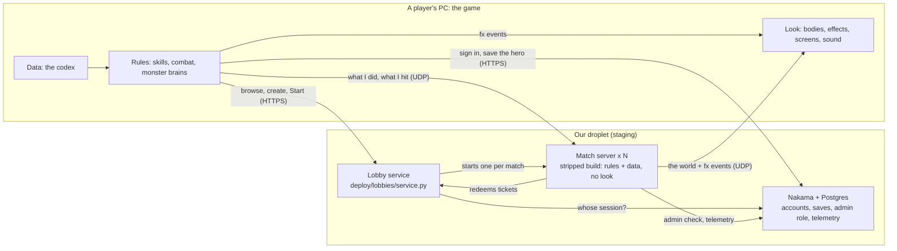

# Multiplayer and servers

How players play together: the two kinds of multiplayer, what runs on our servers, and one match from the lobby to
the end. Who decides a hit is in [combat](combat.md).

## The picture



The droplet also runs Caddy (HTTPS in front of Nakama and the lobby service) and Grafana with Loki (logs and
player numbers, [telemetry](telemetry.md)). `deploy/staging/README.md` lists every service and port.

## Two kinds of multiplayer

| | Enter World and co-op | Battlegrounds, Arena, Sandbox |
|---|---|---|
| Entry | Enter World; Steam friends join your world | Multiplayer: the lobby browser (`mp_lobby_view.gd`, `lobby_client.gd`) |
| Who hosts | the player's own game | our match servers, one process per match |
| Connection | Steam (invites, "Join Game", Steam's relay); LAN and a direct address in the browser's "Local network" row | the droplet's UDP game ports |
| The host leaves | the session ends, and everyone keeps their character | the match runs on |

`MpMode` (`scripts/mp_mode.gd`) holds the switches for what's live: the modes the lobby offers
(`battlegrounds`, `arena`, `sandbox`) and the run rules.

**The modes:**
- **Battlegrounds** (`battlegrounds.gd`): one player can start a match. Players can join late while the raid's entry
  window is open.
- **Arena** (`arena_match.gd`): needs full, balanced teams (1v1, 2v2 or 3v3), Ember against Frost, with no
  friendly fire. The first team to win two rounds wins. A round lasts at most three minutes, after which the team
  with more health left wins it. Tied rounds replay, and a match is a draw after seven rounds. Disconnecting counts
  as leaving the fight.
- **Sandbox** (`sandbox_match.gd`): up to six players, free-for-all, automatic respawns, and nothing is saved.
  "Play Sandbox Solo" runs offline with bots and monster packs.

## One match, step by step

```mermaid
sequenceDiagram
  participant G as Player's game
  participant L as Lobby service
  participant M as Match server
  participant N as Nakama
  G->>N: sign in with this PC's id
  N-->>G: a session
  G->>L: create or join, pick a hero, Ready
  L->>N: whose session is this?
  G->>L: Start (the lobby owner)
  Note over L: everyone Ready? teams full?<br/>memory, CPU and a free port?<br/>one ticket per player
  L->>M: start a process (--server --port 246xx)
  Note over M: loads the map
  M->>L: listening
  G->>L: any news? (polls)
  L-->>G: the address and your ticket
  G->>M: connect (UDP); hello with the ticket and my hero's gear
  M->>L: redeem the ticket (once, within 3 minutes)
  L-->>M: account, team, hero
  Note over M: everyone has arrived: begin
  loop during play
    G->>M: what I did, what I hit
    M-->>G: the world and fx events
    M->>L: still playing (every 10 s)
  end
  M->>L: finished, and the winner
  Note over M: the process quits
  G->>N: save the hero
```

- **The lobby service never runs the game.** It decides who may start, launches one process, and hands out
  one-time tickets (`deploy/lobbies/service.py`). Waiting lobbies use no server.
- **The match server learns who a player is only from a ticket**, which it redeems with the lobby service on the
  same machine (`/worker`, loopback only, with a key made for that match: `scripts/match_instance.gd`).
- **Watchdogs.** A waiting player not seen for 90 s is dropped. A match that goes quiet for 60 s, or runs past its
  mode's time limit (`LIMIT`), is aborted and its process stopped.
- **The gap.** The hero a player brings is whatever their game sends in its hello. The server owning each player's
  build is part of the combat work ([the plan](../architecture_cleanup.md)).
- Item stakes for Arena matches exist in the lobby service (`lobby_stakes.gd`, settlement receipts in SQLite), but
  the lobby screen always creates lobbies without them.

## The rules

1. **One network layer.** `Net` (`scripts/net.gd`) drives everything through Godot's `MultiplayerPeer`. ENet (LAN,
   our servers) and Steam differ only in the peer that is plugged in. Never write transport-specific game code.
2. **The host or match server owns the world:** monsters, loot, the match. Players send what they do, and draw what
   they're told. Today each player's game still works out its own hero's damage ([combat](combat.md)).
3. **Everything a skill shows is an fx event** ([effects](effects.md)). `Hero.fx` plays it locally and sends it once
   (`Net.skill_fx` → `pl_fx`), and every other game plays it on the caster's puppet. No new RPC is needed.
4. **Server code never needs pixels or mesh surfaces.** Match servers run the stripped **Linux Server** export:
   textures have no pixels, and meshes keep only their bounding box. Anything that reads an image or a mesh's
   vertices needs a guard for the empty case (`UI._scaled_tex`, `Flora.oak_model`'s leaves). Collision is
   footprints in code (`World.obstacles`), never mesh data.
5. **A server doesn't animate.** `Enemy.server_nopose` skips posing bodies nobody sees, so bones stay in their rest
   pose. Never make a rule depend on where an animated bone is.
6. **A server ticks at 30 fps** (`Battlegrounds.server_tick`, `match_instance.gd`). Physics stays at 60.
7. **Players and servers must agree on the RPCs.** Builds are not matched by revision (Blaine's call for
   development; don't restore it). A cosmetic client change works with the running servers. A change to an RPC or a
   shared rule needs the match servers updated and a real multiplayer test.
8. A delayed effect on a remote monster checks `still_joined(peer)` before it sends: a world can finish closing after
   its connection has gone.

## Capacity

Measured on the staging droplet (4 GB, 2 vCPU) with bot players (`tools/load_bot.gd`), 2026-11-05:

| One Battlegrounds world | Full game as a server | Stripped server |
|---|---|---|
| Memory | 1.25 GB | ~0.4 GB |
| CPU, empty | 31% of a core | 13% |
| CPU, 6 players fighting | 95% | 24% |

There is no fixed slot count. On Start, `service.py` checks there is room for one more match of that mode (`COST`:
its memory plus headroom, a CPU budget, a free UDP port from 24600). Otherwise the lobby reads "Servers are full
right now" and stays open. Measure a mode with `tools/load_bot.gd` before changing `COST`.

## Accounts and Nakama

Nakama (`scripts/nakama_client.gd`, server module `deploy/nakama/modules/ashen.lua`) holds:
- **accounts**, made from a device id on each PC;
- **a copy of each character save** (`scripts/cloud_saves.gd`; the newest wins);
- **the admin role**;
- **telemetry** ([telemetry](telemetry.md)).

The lobby service asks Nakama whose session a request carries. Where a build connects is in `scripts/build_env.gd`,
which CI writes for each target ([builds](../pipeline/builds.md)).

## Steam

- During development Steam is Spacewar (App ID 480, Valve's test app). Our own App ID comes later, through
  `BuildEnv`'s `steam_app_id`.
- `SteamLink` (`scripts/steam_link.gd`, GodotSteam in `addons/godotsteam`) does all of it:
  - Invite Friends opens your world as a friends-only Steam lobby;
  - a friend's invite or "Join Game" joins it;
  - the lobby browser lists friends' open worlds.
- Without Steam running nothing changes. `-- --steam-selftest` checks a build.
- Friends are Steam friends; there is no friends database of our own.

## Deploying

Deploys are by hand from a checkout. Announce restarts in Discord first.
```
sh deploy/lobbies/update.sh [--force] [ci-run-id]   # match servers + lobby service, from the staging CI's server build
sh deploy/staging/backend.sh                         # Nakama module, compose file, Caddy, Grafana and Loki config
```
- `update.sh` refuses while a match is starting or playing; `--force` ends the match.
- Game ports are UDP 24600 and up, and each must be open in the cloud firewall.
- Logs, first-time setup and connecting a local build to staging are in `deploy/staging/README.md`.

## Testing

- The lobby service has unit tests: `python3 -m unittest discover -s deploy/lobbies -v`.
- For a local service, run `python3 deploy/lobbies/service.py --dev --state <dir> --game "$PWD" --godot <godot>`.
- Then run the game tests against it: `tools/lobby_game_test.gd`, `lobby_modes_test.gd`, `lobby_stakes_test.gd`.
- `tools/bg_test.gd` and `tools/bg_pvp_test.gd` pair a server with players ([builds](../pipeline/builds.md)).
- Read every client and server log for errors, not just the totals.
