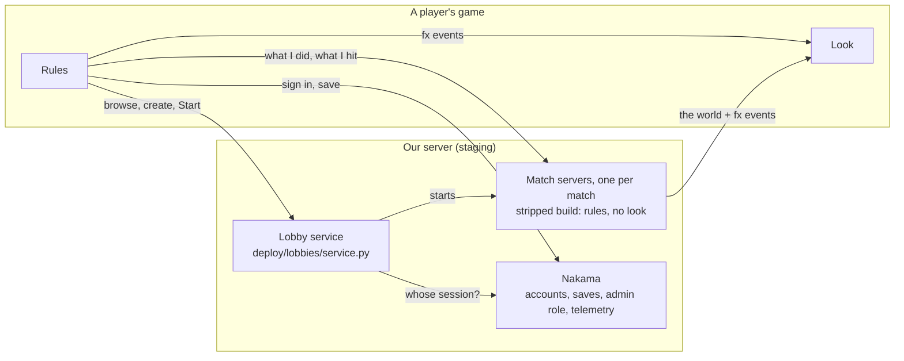
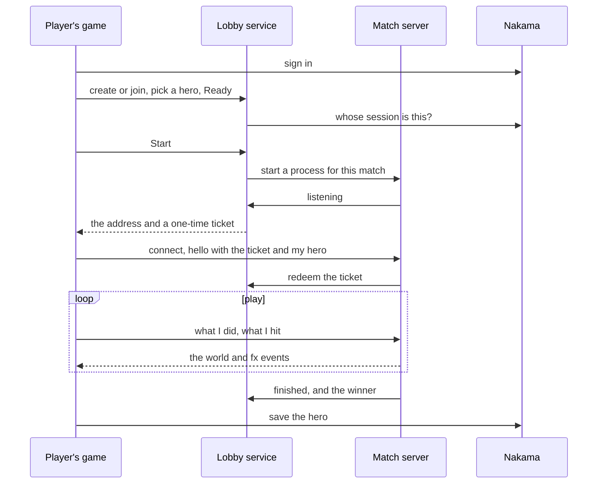

# Multiplayer and servers

## The picture

Multiplayer is the lobby browser, the game's home screen (`game/ui/lobby/`: `mp_lobby_view.gd`, `lobby_client.gd`):
- **Battlegrounds (solo or duo), Arena, Sandbox:** our server runs each match, on the server build of the game that
  made its lobby. `MpMode` (`scripts/mp_mode.gd`) lists which modes are live.

## One match

The lobby service never runs the game: it starts one process per match and hands out tickets. The match server
learns who a player is only from a ticket. The server keeps a copy of each player's build that their game sends it
(`ServerRules.client_tick` → `Net.send_build`), but the player's game still makes the picks, so the server doesn't own the build yet.

## Rules

1. **One network layer.** `Net` (`scripts/net.gd`) drives everything through Godot's `MultiplayerPeer`. ENet and
   Steam differ only in the peer plugged in, so never write transport-specific game code.
2. **The host or match server owns the world** (monsters, loot, the match). Players send what they do and draw what
   they're told. In a match every hero's skills and swings run on the server ([combat](combat.md)); in Enter World
   co-op each player's game still works out its own hero's damage.
3. **Everything a skill shows is an fx event** ([effects](effects.md)), so other players see it with no new RPC.
4. **Server code never needs pixels, mesh surfaces or animated bones.** Match servers run the stripped "Linux
   Server" export. Guard anything that reads an image or a mesh, and keep collision as footprints in code.
5. **Players and servers must agree on the RPCs.** A change to an RPC or a shared rule needs the match servers
   updated and a real multiplayer test.

## Nakama and Steam

- Nakama (`scripts/nakama_client.gd`, module `deploy/nakama/modules/ashen.lua`) holds accounts, a copy of each
  character save (`scripts/cloud_saves.gd`), the admin role and telemetry. `scripts/build_env.gd` says which server
  a build talks to.
- Steam is Valve's test app (Spacewar) during development (its world co-op is archived with Enter World:
  `archive/camp/`).

## Deploying and testing

- Deploys are by hand: `deploy/staging/README.md` has the commands, logs and setup. Announce restarts in Discord.
- Pair tests start a server and players: `game/maps/verdant_reach/tests/bg_test.gd`, `game/maps/verdant_reach/tests/bg_pvp_test.gd` ([builds](../pipeline/builds.md)).
  The lobby service has `python3 -m unittest discover -s deploy/lobbies`.
